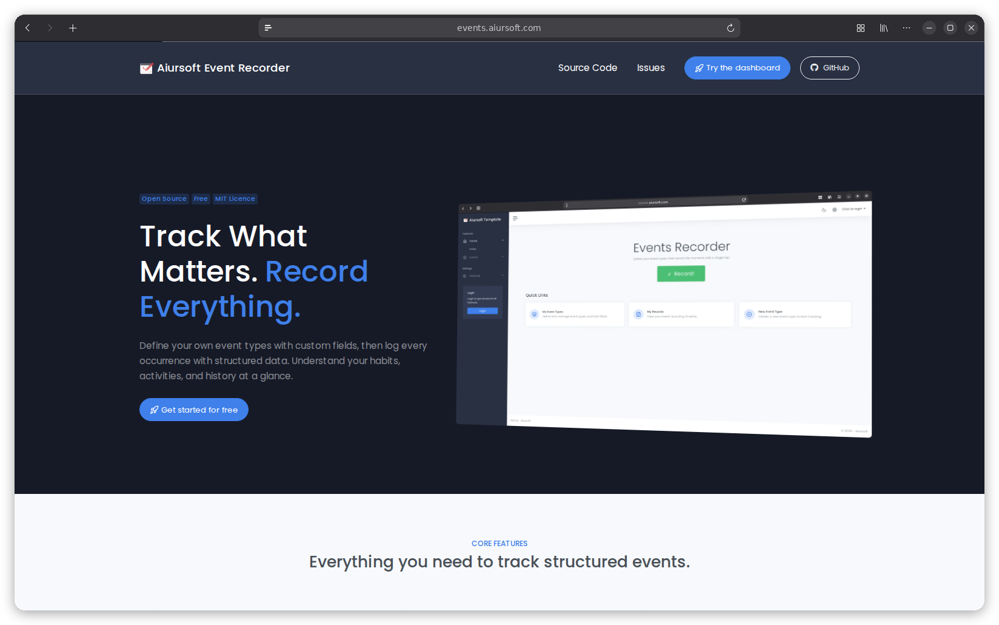

# Aiursoft EventsRecorder - Structured event recording and tracking system

<a name="eventsrecorder---structured-event-recording-and-tracking-system"></a>

[](https://github.com/aiursoftweb/eventsRecorder/blob/master/LICENSE)
[](https://gitlab.aiursoft.com/aiursoft/eventsRecorder/-/pipelines)
[](https://gitlab.aiursoft.com/aiursoft/eventsRecorder/-/pipelines)
[](https://s360.aiursoft.com/SupplyChain?tab=projects&project=aiursoft%2Feventsrecorder&scope=baseline&ecosystem=all)
[](https://manhours.aiursoft.com/r/github.com/aiursoftweb/eventsRecorder.html)
[](https://events.aiursoft.com)
[](https://hub.docker.com/r/aiursoft/eventsrecorder)

EventsRecorder is a structured event recording and tracking system that allows users to define custom event types and log every occurrence with structured data.

## Overview

### What is EventsRecorder?

EventsRecorder is a structured event recording and tracking system that allows users to define custom event types and log every occurrence with structured data.

## Try

Try a running EventsRecorder [here](https://eventsRecorder.aiursoft.com).

## Install with Docker

Run the installer with the desired port (omit it to choose an available port):

```bash
curl -fsSL https://raw.githubusercontent.com/aiursoftweb/eventsrecorder/master/install.sh | sudo bash -s -- 8080
```

Installation starts after three seconds; press Ctrl+C to cancel. Then open `http://localhost:8080`.

## Run manually

Requirements about how to run

1. Install [.NET 10 SDK](http://dot.net/) and [Node.js](https://nodejs.org/).
2. The .NET build automatically runs `npm ci` and `npm run build` to prepare the frontend assets. Node.js and npm must be available when building from source.
3. Execute `dotnet run --project src/Aiursoft.EventsRecorder/Aiursoft.EventsRecorder.csproj -- --urls http://localhost:5000` to run the app.
4. Use your browser to view [http://localhost:5000](http://localhost:5000).

## Run in Microsoft Visual Studio

1. Open the `.sln` file in the project path.
2. Press `F5` to run the app.

## Run in Docker

First, install Docker [here](https://docs.docker.com/get-docker/).

Then run the following commands in a Linux shell:

```bash
image=aiursoft/eventsRecorder
appName=eventsRecorder
sudo docker pull $image
sudo docker run -d --name $appName --restart unless-stopped -p 5000:5000 -v /var/www/$appName:/data $image
```

That will start a web server at `http://localhost:5000` and you can test the app.

The docker image has the following context:

| Properties  | Value                           |
|-------------|---------------------------------|
| Image       | aiursoft/eventsRecorder               |
| Ports       | 5000                            |
| Binary path | /app                            |
| Data path   | /data                           |
| Config path | /data/appsettings.json          |

## Usage

### Insights plugins

Open **My Plugins** after creating event types and records. Choose the event types and fields used by each plugin; the results are calculated when the page loads.

| Plugin | Result |
| --- | --- |
| Weekly Review | This and last week's record counts, change, and active days. |
| Time Investment | Hours recorded in a duration field this week, last week, and over 30 days. |
| Personal Best | Maximum and latest values of a numeric field, their gap, and days since the best. |
| Weekly Goal | Active days against a target of 1–7 days per week. |
| Recording Rhythm | Typical and latest gaps, variation between gaps, and time since the last record. |
| Event Association | Compares a numeric outcome when a selected event occurred in the preceding 24 hours with other outcomes. The comparison does not show cause and effect. |

Weekly counts use UTC weeks starting Monday. The association plugin shows group averages only when each group has at least three outcomes.



Default user name is `admin@default.com` and default password is `Admin@123456!`.

## Configuration

The application defaults are defined in [`src/Aiursoft.EventsRecorder/appsettings.json`](src/Aiursoft.EventsRecorder/appsettings.json). The Docker image initializes `/data/appsettings.json` on its first start and keeps it for later starts; persist `/data`. Override nested values with double-underscore environment variables, such as `Logging__LogLevel__Default`.

```jsonc
{
  "ConnectionStrings": {
    "AllowCache": "True",

    "DbType": "Sqlite",
    "DefaultConnection": "DataSource=app.db;Cache=Shared"

    // sudo docker run -d --name db -e MYSQL_RANDOM_ROOT_PASSWORD=true -e MYSQL_DATABASE=events-recorder -e MYSQL_USER=events-recorder -e MYSQL_PASSWORD=events-recorder-password -p 3306:3306 hub.aiursoft.com/mysql
    //"DbType": "MySql",
    //"DefaultConnection": "Server=localhost;Database=events-recorder;Uid=events-recorder;Pwd=events-recorder-password;"
  },
  "Storage": {
    "Path": "/tmp/data",
    "PublicOrigin": "",
    "RequireDedicatedInlineOrigin": false,
    "AllowArbitraryInlineOnDedicatedOrigin": false,
    "SafeInlineMediaExtensions": ["svg"],
    "SafeInlineSvgSubfolders": ["project-logo"],
    "UploadPolicy": {
      "RequireAuthenticatedUser": false,
      "ReplaceSpacesWithHyphens": false
    }
  },
  "AppSettings": {
    "AuthProvider": "Local", // OIDC or Local
    "DefaultRole": "",
    "PersistsSignIn": false,
    "OIDC": {
      // https://auth.aiursoft.com/application/o/events-recorder
      "Authority": "https://auth.aiursoft.com/application/o/events-recorder",
      "ClientId": "",
      "ClientSecret": "",
      "RolePropertyName": "groups",
      "UsernamePropertyName": "preferred_username",
      "UserDisplayNamePropertyName": "name",
      "EmailPropertyName": "email",
      "UserIdentityPropertyName": "sub"
    },
    "Local": {
      "AllowRegister": true,
      "AllowWeakPassword": true
    }
  },
  "GlobalSettings": {
    // You can initialize or override global settings here.
    // "Allow_User_Adjust_Nickname": "True",
    // "BrandName": "Aiursoft",
    // "BrandHomeUrl": "https://www.aiursoft.com/",
    // "Icp": "",
    // "ProjectName": "Aiursoft Event Recorder"
  },
  "Logging": {
    "LogLevel": {
      "Default": "Information",
      "Microsoft.AspNetCore": "Warning"
    },
    "Clickhouse": {
      "Enabled": false,
      "ConnectionString": "Host=localhost;Protocol=http;Port=8123;User=default;Password=;Database=AspNetCoreLogs",
      "TableName": "EventsRecorderLogs"
    }
  },
  "AllowedHosts": "*"
}
```

### Shared settings

- `ConnectionStrings` selects the database provider and connection. Prepare the external database before choosing MySQL; keep the SQLite file persistent when using SQLite.
- `Storage` configures local application files. Keep the storage directory persistent and use the documented hostname and upload policies for shared downloads.
- `AppSettings` controls authentication and account synchronization. Choose local accounts or configure the OIDC authority, client and `/signin-oidc` callback; use environment variables for credentials.
- Uncommented `GlobalSettings` entries override the database-backed administration settings. Leave entries commented to use the stored values or application defaults.
- `Logging:LogLevel` controls application and framework verbosity. Configure the optional ClickHouse exporter only when its server and credentials are ready.
- `AllowedHosts` is the ASP.NET Core Host-header allowlist, not a CORS setting.

## How to contribute

There are many ways to contribute to the project: logging bugs, submitting pull requests, reporting issues, and creating suggestions.

Even if you with push rights on the repository, you should create a personal fork and create feature branches there when you need them. This keeps the main repository clean and your workflow cruft out of sight.

We're also interested in your feedback on the future of this project. You can submit a suggestion or feature request through the issue tracker. To make this process more effective, we're asking that these include more information to help define them more clearly.

## License

Licensed under the [MIT License](LICENSE).
